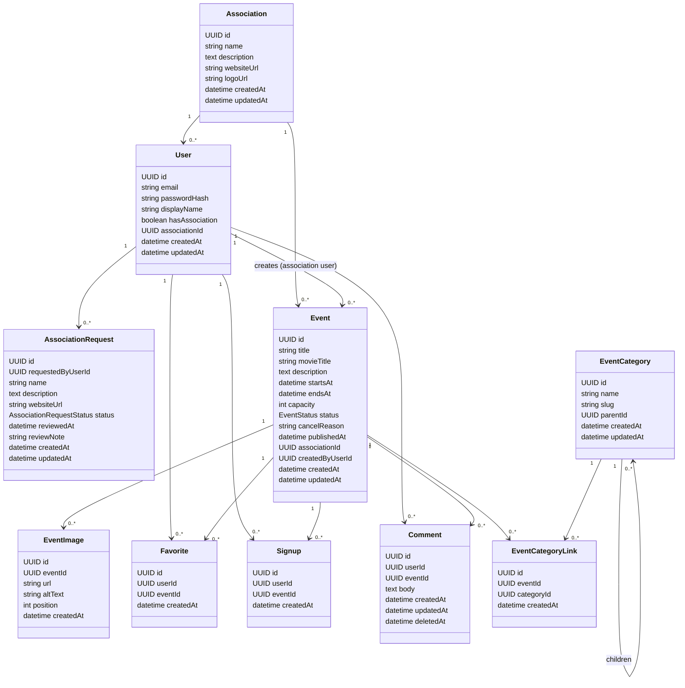

# Modèles de classes (Backend) — Évènements caritatifs cinéma

Ce document décrit un **modèle de domaine minimal** permettant d’implémenter les user stories : consultation/recherche/filtrage des évènements, comptes, favoris (likes), inscriptions, dashboard, commentaires, et gestion d’évènements (création/publication/modification/annulation + images + liste des inscrits).

> Hypothèses retenues (simples, ajustables)
> - Publication gérée par un champ **statut** (brouillon/publié/annulé).
> - Pas de notification aux participants lors d’une annulation (simple changement de statut + affichage).
> - Filtrage visiteur a minima : **date** et **lieu** (+ optionnellement statut/presque complet).
> - Un utilisateur peut avoir **au plus un commentaire par évènement** (cohérent avec “modifier mon commentaire”).
> - Pas de notion d’admin dédiée : un utilisateur “éditeur” est un utilisateur **rattaché à une association**.
> - Les utilisateurs peuvent faire une **demande** pour créer une association (workflow simple \"pending/approved/rejected\").
> - Les évènements ont des **catégories hiérarchiques** (catégorie parent / catégories enfants).

---

## 1) Enums / Value Objects

### `EventStatus`
- `DRAFT` : visible uniquement par l’association éditrice (et le créateur)
- `PUBLISHED` : visible par tous
- `CANCELLED` : visible par tous (avec mention “annulé”)

### `AssociationRequestStatus`
- `PENDING`
- `APPROVED`
- `REJECTED`

### `Location` (value object)
Champs typiques (adaptables selon votre UI) :
- `name` (ex: “Cinéma Lumière”)
- `addressLine1`
- `postalCode`
- `city`
- `country`
- `lat`, `lng` (optionnel)

---

## 2) Entités principales

### `User`
Représente un utilisateur (compte).

**Champs**
- `id: UUID`
- `email: string` (unique)
- `passwordHash: string`
- `displayName: string`
- `hasAssociation: boolean`
- `associationId: UUID?` (FK -> `Association`, nullable)
- `createdAt: datetime`
- `updatedAt: datetime`
- `disabledAt: datetime?` (optionnel)

**Règles/contraintes**
- `email` unique.
- Cohérence : si `hasAssociation == true` alors `associationId` non-null.
- Un utilisateur sans association est un “utilisateur normal” (peut liker/s’inscrire/commenter).
- Un utilisateur rattaché à une association peut en plus **créer/publier/modifier/annuler** des évènements.

### `Association`
Organisation/association qui publie et fait la promotion des évènements.

**Champs**
- `id: UUID`
- `name: string`
- `description: text?`
- `websiteUrl: string?`
- `logoUrl: string?` (optionnel)
- `createdAt: datetime`
- `updatedAt: datetime`

**Relations**
- 1 `Association` — N `User` (membres de l’association)
- 1 `Association` — N `Event` (évènements publiés)

### `AssociationRequest`
Demande (workflow) faite par un utilisateur pour créer une association.

**Champs**
- `id: UUID`
- `requestedByUserId: UUID` (FK -> `User`)
- `name: string`
- `description: text?`
- `websiteUrl: string?`
- `status: AssociationRequestStatus`
- `reviewedAt: datetime?`
- `reviewNote: string?` (raison de refus, commentaires…)
- `createdAt: datetime`
- `updatedAt: datetime`

**Règles/contraintes**
- Un utilisateur peut avoir au plus **une demande PENDING** à la fois (recommandé).
- À l’approbation : création d’une `Association` + rattachement de l’utilisateur (mise à jour `User.associationId` / `hasAssociation`).

### `Event`
Evènement caritatif autour d’un film/projection.

**Champs**
- `id: UUID`
- `title: string` (titre d’affiche de l’évènement)
- `movieTitle: string` (recherche “nom du film”)
- `description: text`
- `startsAt: datetime`
- `endsAt: datetime?`
- `location: Location` (ou normalisé via table `Venue`, selon choix)
- `capacity: int?` (optionnel ; si absent ⇒ capacité illimitée)
- `status: EventStatus` (`DRAFT|PUBLISHED|CANCELLED`)
- `cancelReason: string?` (optionnel)
- `associationId: UUID` (FK -> `Association`)
- `createdByUserId: UUID` (FK -> `User`, doit avoir `hasAssociation == true`)
- `publishedAt: datetime?`
- `createdAt: datetime`
- `updatedAt: datetime`

**Relations**
- 1 `Event` — N `EventImage`
- 1 `Event` — N `Favorite`
- 1 `Event` — N `Signup`
- 1 `Event` — N `Comment`
- 1 `Event` — N `EventCategoryLink`

**Règles/contraintes**
- Un évènement est **consultable publiquement** si `status in (PUBLISHED, CANCELLED)`.
- Publication : `DRAFT -> PUBLISHED` fixe `publishedAt`.
- Annulation : `PUBLISHED -> CANCELLED` (conserve l’historique).
- Seuls les utilisateurs rattachés à une association peuvent créer/publier/modifier/annuler des évènements.
- Inscriptions : si `capacity` est défini, `signups.count <= capacity`.

### `EventImage`
Images d’illustration associées à un évènement.

**Champs**
- `id: UUID`
- `eventId: UUID` (FK -> `Event`)
- `url: string` (ou `storageKey` si vous stockez côté serveur)
- `altText: string?`
- `position: int` (ordre d’affichage)
- `createdAt: datetime`

**Règles/contraintes**
- `position` unique par `eventId` (recommandé).

---

## 3) Interactions (likes / inscriptions / commentaires)

### `Favorite` (ex-\"Like\")
Favori d’un utilisateur sur un évènement.

**Champs**
- `id: UUID`
- `userId: UUID` (FK -> `User`)
- `eventId: UUID` (FK -> `Event`)
- `createdAt: datetime`

**Contraintes**
- Unicité : `(userId, eventId)` unique.
- Autorisé seulement si l’utilisateur est connecté.
- Autorisé seulement si l’évènement est visible (souvent `PUBLISHED`, et au choix `CANCELLED` non likable).

### `Signup`
Participation/inscription d’un membre à un évènement.

**Champs**
- `id: UUID`
- `userId: UUID` (FK -> `User`)
- `eventId: UUID` (FK -> `Event`)
- `createdAt: datetime`

**Contraintes**
- Unicité : `(userId, eventId)` unique.
- Autorisé seulement si `Event.status == PUBLISHED`.
- Si `capacity` est défini, refuser l’inscription quand plein.

### `Comment`
Commentaire d’un membre sur un évènement.

**Champs**
- `id: UUID`
- `userId: UUID` (FK -> `User`)
- `eventId: UUID` (FK -> `Event`)
- `body: text`
- `createdAt: datetime`
- `updatedAt: datetime`
- `deletedAt: datetime?` (optionnel : soft delete)

**Contraintes**
- Unicité recommandée : `(userId, eventId)` unique (1 commentaire par évènement et par membre).
- Modification/suppression : uniquement par l’auteur (et optionnellement modération par l’association).

---

## 4) Projections / vues utiles (pas forcément des tables)

### Dashboard (Membre)
Le “dashboard” se construit via requêtes :
- Favoris : `Event` joints avec `Favorite` (par `userId`) et `Event.status != DRAFT`.
- Participations : `Event` joints avec `Signup` (par `userId`).

### Liste des inscrits (Association)
Pour un évènement publié par une association :
- `User` joints avec `Signup` filtré par `eventId`.

---

## 5) Filtrage / recherche (Visiteur)

### Champs minimum à supporter
- **Recherche film** : `movieTitle` (LIKE / full-text selon techno)
- **Filtre date** : intervalle `[from, to]` appliqué à `startsAt`
- **Filtre lieu** : par `city` (et/ou `postalCode`)
- **Filtre catégorie** : par catégorie (et optionnellement inclure les enfants)
- Toujours filtrer côté visiteur sur `status in (PUBLISHED, CANCELLED)`

---

## 6) Catégories (hiérarchie parent/enfant)

### `EventCategory`
Catégorie d’évènements. La hiérarchie est modélisée avec une relation récursive (adjacency list).

**Champs**
- `id: UUID`
- `name: string`
- `slug: string` (unique, pratique pour URLs)
- `parentId: UUID?` (FK -> `EventCategory`, nullable)
- `createdAt: datetime`
- `updatedAt: datetime`

**Règles/contraintes**
- `parentId` nullable pour les catégories racines.
- Éviter les cycles (contrainte applicative).

### `EventCategoryLink`
Association entre un évènement et une ou plusieurs catégories.

**Champs**
- `id: UUID`
- `eventId: UUID` (FK -> `Event`)
- `categoryId: UUID` (FK -> `EventCategory`)
- `createdAt: datetime`

**Contraintes**
- Unicité : `(eventId, categoryId)` unique.
- Si vous voulez imposer \"1 seule catégorie\" : contrainte unique sur `(eventId)`.

---

## 7) Index recommandés (DB)

- `Event(status, startsAt)`
- `Event(movieTitle)` (ou index full-text)
- `Event(location.city)` si `Location` est stocké en colonnes
- `Favorite(userId, eventId)` unique
- `Signup(userId, eventId)` unique
- `Comment(userId, eventId)` unique (si contrainte activée)
- `EventCategory(slug)` unique
- `EventCategory(parentId)`
- `EventCategoryLink(eventId, categoryId)` unique
- `AssociationRequest(requestedByUserId, status)` (recommandé)

---

## 8) Diagramme (Mermaid)

